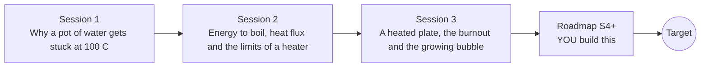

# openboiling

[](https://github.com/KrunalPanchal1995/openboiling/actions/workflows/ci.yml)   [](https://colab.research.google.com/github/KrunalPanchal1995/openboiling/blob/main/sessions/session-01/lesson.ipynb) [](https://krunalpanchal1995.github.io/openboiling/)

**Model boiling and bubble growth on a heated surface, in three sessions.**

openboiling teaches why a hot surface under water can boil safely at 100 C and yet burn out when the power rises past a limit, using only Python and a browser.

- **Start from a pot of water.** Session 1 needs only school arithmetic: energy to warm and energy to boil.
- **See the burnout.** Session 3 steps a heated plate through time and shows how the surface jumps from safe to red hot.
- **Know you got it right.** Each session ends with a checkpoint that prints PASS or FAIL against hand calculations and an exact solution.
- **Build the missing half.** The repo stops at Session 3 on purpose; the roadmap shows the path to the Target.

[Target](#the-target) · [Who is this for](#who-is-this-for) · [Quick start](#quick-start) · [Sessions](#sessions) · [Roadmap](#roadmap) · [Contribute](#contribute) · [Explainer PDF](docs/explainer.pdf)

> **This repo is incomplete on purpose.** Sessions 1 to 3 are here and fully working. The finished Target below is a preview of what the community can build next. We show you the path, not the code. Sessions 4 and up are yours.

## The Target

A heated surface under water, animated beside its boiling curve. As the power rises, bubbles multiply and the red operating point climbs the steep nucleate branch; at the critical heat flux of about 1.1 MW per square metre a vapour film suddenly blankets the surface and the point jumps across to a far hotter state. A second, green point shows a temperature-controlled heater that simply walks over the peak and never jumps. Your goal over the coming sessions: build the physics behind both markers yourself.


*Target: a boiling surface and the jump at the critical heat flux (illustrative model)*


*A frame from the Target: vapour film after burnout, power-controlled versus temperature-controlled*


*The four regimes of pool boiling on one curve (illustrative)*

Try it live:

- [Math Visual Studio: the first law of thermodynamics (Atlas S53)](https://krunalpanchal1995.github.io/studio/#atlas?ch=S53&ex=1)
- [Math Visual Studio: heat diffusion project (Atlas S102)](https://krunalpanchal1995.github.io/studio/#atlas?ch=S102&ex=1)

How the Target was made is shown only as a path in [promo/roadmap.md](promo/roadmap.md).

## Who is this for
**higher secondary to diploma / undergraduate (levels 4-5).** Topic area: Heat, Thermodynamics and Fluid Mechanics.

Prerequisites:

- Arithmetic with powers and a cube root; the idea that heat is energy (joules) and power is energy per second (watts).
- Python 3.10 or newer; if `python --version` works, you are ready. PRIMER.md explains the rest.
- No prior GitHub, thermodynamics or fluid mechanics experience is needed.

New to Python? Read [PRIMER.md](PRIMER.md) first (10 minutes).

## Quick start

No installation knowledge needed. You need [Git](https://git-scm.com/downloads) and [Python 3.10+](https://www.python.org/downloads/) (Windows: tick "Add Python to PATH"). On Mac and Linux type `python3` wherever this page says `python`.

```bash
git clone https://github.com/KrunalPanchal1995/openboiling.git
cd openboiling
python start.py 1
```

`start.py` creates a private environment, installs what is needed and runs Session 1 with its checkpoint. Next: `python start.py 2`, `python start.py 3`, or `python start.py test` to check everything. Only a checkpoint: `python start.py check 1`.

Four lines turn the idea of Session 1 into a result (they work as they are): Save it as `try.py` and run it with `python start.py run try.py` (this uses the private environment, where NumPy is installed):

```python
import numpy as np
m, cp, eff, power = 1.0, 4186.0, 0.85, 2000.0     # kg, J/(kg K), -, W
t_boil = m * cp * (100 - 20) / (eff * power)       # seconds to reach 100 C
print(round(t_boil), 's to boil 1 kg of water at 2 kW')   # -> 197 s
```

Every session also opens in your browser with sliders (no install): [live apps](https://krunalpanchal1995.github.io/openboiling/). Or use the Colab badge above for the notebook.

## Sessions

| # | Session | Model level | Time | Live app |
|---|---|---|---|---|
| 1 | [Why a pot of water gets stuck at 100 C](sessions/session-01/README.md) | Level 1: conceptual interactive model | 60 min | [open](https://krunalpanchal1995.github.io/openboiling/session-01/) |
| 2 | [Energy to boil, heat flux and the limits of a heater](sessions/session-02/README.md) | Level 2: mathematical engineering model | 75 min | [open](https://krunalpanchal1995.github.io/openboiling/session-02/) |
| 3 | [A heated plate, the burnout and the growing bubble](sessions/session-03/README.md) | Level 3: simulation and validation | 90 min | [open](https://krunalpanchal1995.github.io/openboiling/session-03/) |

Each session follows the same six steps: A real-world problem, B concept and theory, C visual explanation, D interactive simulation, E worked example and experiment, F assessment and design challenge. Each ends with `checkpoint.py`, which prints `PASS` or `FAIL` against reference numbers. Session 3 also contains the real-world mini-project: **Choose a safe heater power for a boiling surface**.

## Architecture



| Folder or file | What is inside |
|---|---|
| `sessions/` | three sessions: README (A-F), `lesson.py`, notebook, live app, exercises, activity sheet, checkpoint |
| `promo/` | the Target: media, live links, and the roadmap (path only) |
| `docs/` | `explainer.tex` and the built `explainer.pdf` |
| `tests/` | runs every lesson and checkpoint headless |
| `start.py` | one command to set up and run anything |
| `QUALITY.md`, `RUBRIC.md` | the quality checklist and the scoring rubric |
| `.github/` | CI, PDF build, Pages deploy, issue and PR templates |

## Roadmap

| Milestone | What you will build | Difficulty |
|---|---|---|
| Session 4: Replace the hand-picked curve with correlations | A boiling curve computed from fluid properties at any pressure. | intermediate |
| Session 5: A spherical bubble in the superheated liquid | A radial diffusion solver for the growing bubble. | advanced |
| Session 6: A plate with a temperature profile | A plate meshed in thickness with boiling as the boundary condition. | intermediate |
| Session 7: From one bubble to a flux | A bubble-ensemble model that predicts the nucleate flux. | advanced |
| Session 8: Watch a bubble leave in 2D | A two-dimensional simulation of a bubble growing, necking and departing. | advanced |

Full detail with a checkpoint per milestone: [promo/roadmap.md](promo/roadmap.md).

## Contribute
New to GitHub? Read [CONTRIBUTING.md](CONTRIBUTING.md); it starts from zero. Pick an issue labelled `good first issue`. Translations into Hindi, Telugu, Tamil and Malayalam are welcome.

<details>
<summary>Development</summary>

```bash
python start.py test        # runs every lesson and checkpoint
```
Lessons use `# %%` cell markers so they open as notebooks in VS Code. See [QUALITY.md](QUALITY.md) for the standard every session meets.
</details>

## License
MIT. See [LICENSE](LICENSE). Media in `promo/media` is (c) Krunal Panchal, CC BY 4.0.

## Acknowledgments
Part of the [PAN IIT OSS](https://hellofoss.tech-iitb.org/projects) open-source teaching collection, modelled on the structure of [openspline](https://github.com/openspline/openspline). Built on ideas from the Math Visual Studio at https://krunalpanchal1995.github.io/studio/.
