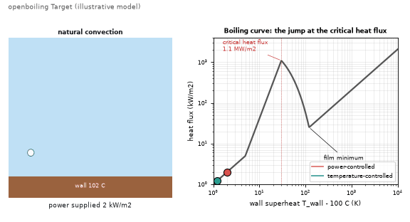
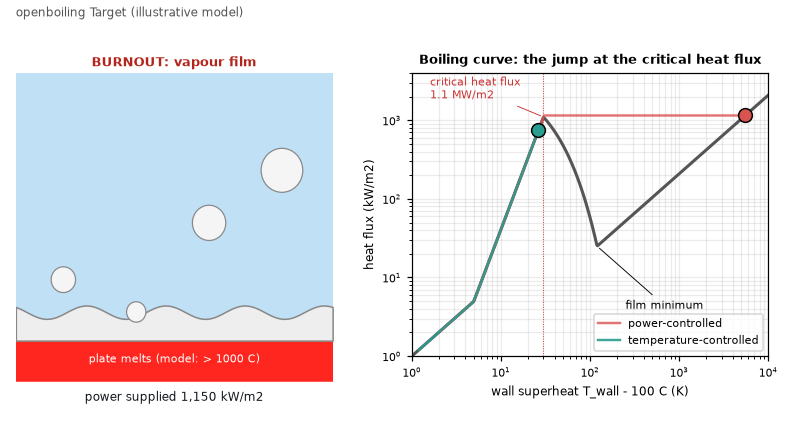
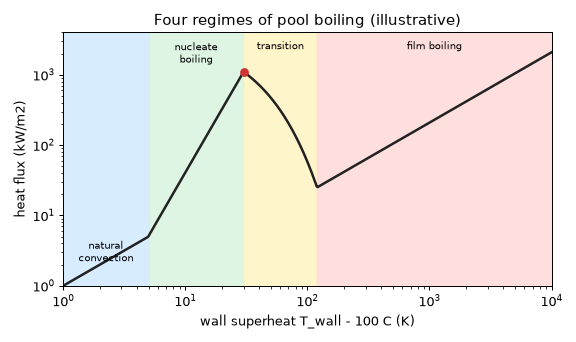

# What you are building toward

A heated surface under water, animated beside its boiling curve. As the power rises, bubbles multiply and the red operating point climbs the steep nucleate branch; at the critical heat flux of about 1.1 MW per square metre a vapour film suddenly blankets the surface and the point jumps across to a far hotter state. A second, green point shows a temperature-controlled heater that simply walks over the peak and never jumps. Your goal over the coming sessions: build the physics behind both markers yourself.

*Target: a boiling surface and the jump at the critical heat flux (illustrative model)*

*A frame from the Target: vapour film after burnout, power-controlled versus temperature-controlled*

*The four regimes of pool boiling on one curve (illustrative)*

These results come from a private reference build. The code is not published; the roadmap shows the path so you can build your own.

Live links:

- [Math Visual Studio: the first law of thermodynamics (Atlas S53)](https://krunalpanchal1995.github.io/studio/#atlas?ch=S53&ex=1)
- [Math Visual Studio: heat diffusion project (Atlas S102)](https://krunalpanchal1995.github.io/studio/#atlas?ch=S102&ex=1)
