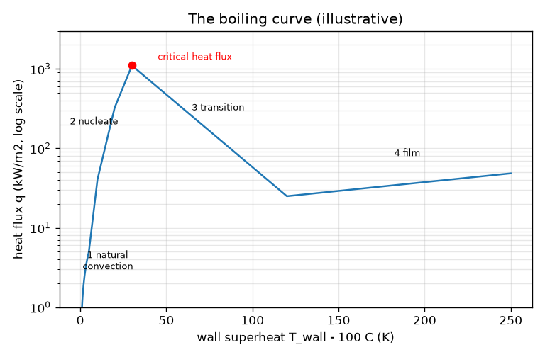
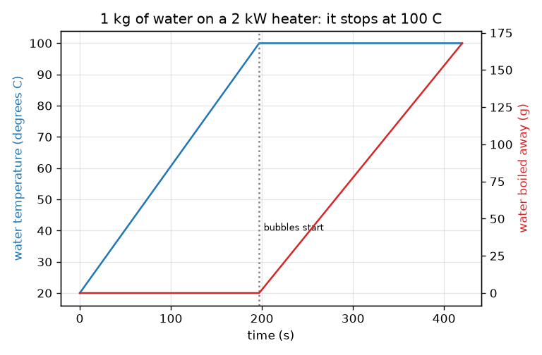

# Session 1: Why a pot of water gets stuck at 100 C

*Level 1 (conceptual interactive model) · about 60 minutes · openboiling*

> This is a simplified educational model. It is not a validated design tool and must not be used for real structures, electrical installations, vehicles, industrial processes or medical decisions.

**Prerequisites**

- Arithmetic and reading a graph.
- You have read PRIMER.md and run `python start.py 1` once.

**Learning objectives.** After this session you can:

- Explain why the temperature stops rising when water boils.
- Compute the time to reach the boiling point and the mass boiled away, from power and mass.
- Name the four stages of the boiling curve and say which has bubbles.
- Read a graph of heat flux against surface temperature above boiling.

## A. Real-world problem
You put a pot of water on the stove. For a few minutes it just gets warmer. Then bubbles appear at the bottom and the temperature stops rising, although the heater still pours energy in. Where does the energy go? And why do bubbles start on the hot surface, not in the middle of the water? (General education only: this is not advice for operating real heating equipment.)

## B. Concept and theory
Heat is energy, measured in joules (J); power is energy per second, in watts (W). Warming m kilograms of water by a temperature difference dT needs m cp dT, where cp = 4186 J/(kg K) is how much energy 1 kg needs for 1 K. At the boiling point (100 C at normal air pressure) extra energy L = 2.257 million J per kilogram is needed to turn the water into steam; the water stays at 100 C while this happens. Bubbles form on the heater surface because the water touching the metal is hotter than the water further away. Now imagine holding the metal at dT kelvin above the boiling point and measuring the heat flux q, in watts per square metre, leaving it. The boiling curve plots q against dT and has four stages: natural convection (no bubbles), nucleate boiling (bubbles, very steep rise), the critical heat flux followed by transition boiling (flux falls), and film boiling (a vapour blanket insulates the surface).

| Symbol | Meaning | Unit |
|---|---|---|
| m | mass of water | kg |
| cp | specific heat of liquid water (4186) | J/(kg K) |
| L | latent heat of vaporisation (2.257e6) | J/kg |
| P | heater power | W |
| eta | fraction of power reaching the water (0.85) | no unit |
| dT | surface temperature above the boiling point | K |
| q | heat flux leaving the surface | W/m2 |

**Assumptions**

- Water at normal air pressure, boiling point 100 C.
- Uniform water temperature; no heat lost to the room except through the efficiency eta.
- The boiling-curve numbers are illustrative; real values depend on the surface.

$$ t_{\mathrm{boil}}=\frac{m\,c_p\,(100-T_0)}{\eta\,P} $$

$$ \dot m_{\mathrm{steam}}=\frac{\eta\,P}{L}\qquad(\text{once the water is at }100\,^\circ\mathrm{C}) $$

$$ q=\frac{\text{heat leaving the surface}}{\text{area}}\quad[\mathrm{W/m^2}] $$

## C. Visual explanation
The first figure shows 1 kg of water on a 2 kW heater: the temperature climbs in a straight line, then goes flat at 100 C after 197 s, while the red curve of boiled-away mass starts to rise. The second figure is the boiling curve on a logarithmic flux axis. It rises steeply in the nucleate stage up to a peak near 1100 kW/m2 at 30 K, falls to a minimum of about 25 kW/m2 at 120 K and rises slowly again in film boiling. Note that a surface 200 K above boiling carries about the same heat flux as one only 10 K above (about 38 and 41 kW/m2).

*The boiling curve with its four stages and the critical heat flux (illustrative numbers).*

*1 kg of water on a 2 kW heater: temperature stops at 100 C after 197 s while the boiled-away mass grows.*

## D. Interactive simulation
Run the lesson (`python start.py 1`), then open the live app: [Session 1: heat the pot and find the boiling curve](https://krunalpanchal1995.github.io/openboiling/session-01/) (or `app.html` in this folder). Raise the heater power and watch the boiling time fall; drag the time slider past the boiling point and see the temperature go flat and the water level drop. Then open the boiling-curve view and move the surface slider through the four stages.

**Challenge.** Get the water boiling within 3 minutes of heating and keep heating until at least 50 g has boiled away.

## E. Worked example and experiment
**Problem.** 1 kg of water at 20 C on a 2000 W heater with efficiency 0.85. When does it boil, and how much water has boiled away 5 minutes later?

1. Energy to warm it: m cp dT = 1 * 4186 * 80 = 334 880 J.
2. Useful power: 0.85 * 2000 = 1700 W.
3. Time to boil: 334 880 / 1700 = 197 s (3 minutes 17 seconds).
4. During the next 300 s the energy is 1700 * 300 = 510 000 J, all of it making steam.
5. Mass boiled away: 510 000 / 2.257e6 = 0.226 kg.

**Answer.** It boils after 197 s; 5 minutes later it is still at 100 C and 226 g (22.6 percent) has boiled away.

**Experiment.** Heat 1 litre of water in a kettle or pot on a plate with a known power (read it from the label), time how long until bubbles appear all over the bottom, and weigh the pot before and after 5 minutes of boiling. You should find a time within about 20 percent of the model and a mass loss close to the model. Differences: the real heater loses energy to the room and the pot, so the real efficiency is lower than 0.85; small air bubbles appear well before 100 C because dissolved air comes out of the water, which the model ignores.

## F. Assessment and design challenge
**Question type A: Conceptual.** The heater keeps delivering 2000 W once the water is boiling, yet the temperature stays at 100 C. Where does the energy go?

Hint

Think about what leaves the pot.

Step-by-step solution

It goes into the latent heat: the energy that turns liquid water into steam. About 2.257 million joules are needed for each kilogram, and the steam carries that energy away. The temperature of boiling water cannot rise at fixed pressure, so all the additional energy becomes vapour, at a rate of eta P / L kilograms per second.

**Question type B: Numerical.** 1.5 kg of water at 20 C on an 1800 W heater (efficiency 0.85). How long until it boils, and how much boils away in the next 2 minutes?

Hint

Use t = m cp dT / (eta P), then the mass rate eta P / L.

Step-by-step solution

Time = 1.5 * 4186 * 80 / (0.85 * 1800) = 502 320 / 1530 = 328 s (about 5.5 minutes). Then boiled mass = 0.85 * 1800 * 120 / 2.257e6 = 183 600 / 2.257e6 = 0.081 kg = 81 g. Sanity check: 2 minutes of boiling removes only about 5 percent of the water, much less than the 328 s of warming would suggest, because L is 540 times cp.

**Question type C: Graph and simulation interpretation.** On the boiling curve, compare the heat flux of a surface 10 K above boiling, one 60 K above and one 200 K above. Name the stage of each. What is surprising?

Hint

Use the readout of the boiling-curve view, or the numbers printed by lesson.py.

Step-by-step solution

10 K: nucleate boiling, about 41 kW/m2. 60 K: transition boiling, about 312 kW/m2 (the largest of the three, but past the peak). 200 K: film boiling, about 38 kW/m2. It is surprising that the surface at 200 K, 190 K hotter, carries about the same heat flux as the one at 10 K: the vapour blanket insulates it. The curve is not monotonic.

**Question type D: Design and optimisation challenge.** Design: choose a heater power so that 1 litre (1 kg) of water boils in 3 minutes from 20 C, then say how much water you lose in 10 minutes if you leave it at that power. Suggest a better way to keep it boiling.

Hint

Solve t = m cp dT / (eta P) for P, then use eta P / L for the mass rate.

Step-by-step solution

P = 334 880 / (0.85 * 180) = 2189 W, so a 2.2 kW heater. Left at that power, the boil-off rate is 0.85 * 2189 / 2.257e6 = 0.82 g/s, so about 495 g in 10 minutes: half the water. Better: turn the power down once boiling starts. To keep a gentle boil you only need enough power to replace the heat losses plus the steam you accept, for example a quarter of the power loses about a quarter as much water. Trade-off: faster start against water loss and energy use. Assumptions: constant efficiency, no lid.

Score yourself with [RUBRIC.md](../../RUBRIC.md). Print the [activity sheet](activity_sheet.md) to work on paper.

## Common misconceptions
| Common misconception | What is actually true |
|---|---|
| Water boils because it has been heated for a long time. | It boils when it reaches the boiling temperature; after that more heating makes more steam, not a hotter liquid. |
| Bubbles that appear well before 100 C mean the water is already boiling. | Those are mostly dissolved air coming out of solution; real boiling bubbles are filled with steam and fill the whole bottom. |
| A hotter surface always carries more heat into the water. | Past the critical heat flux the vapour blanket makes the flux fall; a very hot surface can transfer less heat than a moderately hot one. |
| Boiling water at 100 C is the same as steam at 100 C in terms of energy. | Steam holds the extra latent heat, 2.257 million joules per kilogram, more than five times the energy needed to warm the same water from 0 C to 100 C. |

## Glossary
- **specific heat**: energy needed to warm 1 kg of a material by 1 K (4186 J/(kg K) for water)
- **latent heat**: energy needed to turn 1 kg of liquid into vapour at constant temperature
- **heat flux**: heat per second per unit area leaving a surface, in W/m2
- **superheat**: how many kelvin the surface is above the boiling point
- **boiling curve**: graph of heat flux against surface superheat
- **critical heat flux**: the peak of the boiling curve, the largest flux nucleate boiling can carry

## Finish
1. Do the three coding tasks in [exercises.md](exercises.md).
2. Run `python start.py 1` again after your changes. It ends with the checkpoint; when it prints `PASS`, you are done. (Checkpoint only: `python start.py check 1`.)

Next: [Session 2](../session-02/README.md)
