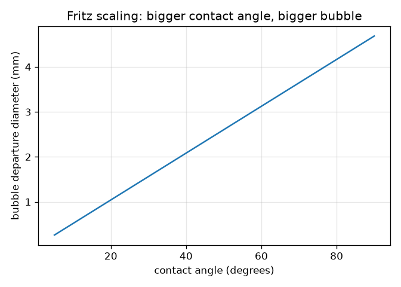
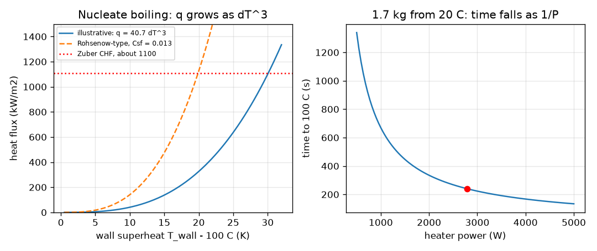

# Session 2: Energy to boil, heat flux and the limits of a heater

*Level 2 (mathematical engineering model) · about 75 minutes · openboiling*

> This is a simplified educational model. It is not a validated design tool and must not be used for real structures, electrical installations, vehicles, industrial processes or medical decisions.

**Prerequisites**

- Session 1: energy to warm and to boil, the boiling curve.
- Cube and cube root; reading a log-free graph.

**Learning objectives.** After this session you can:

- Compute the power and heating time for a given mass and temperature rise with Q = m cp dT + m L.
- Use q = eta P / A and the empirical scaling q proportional to dT cubed to find the wall superheat of a heater.
- Estimate the critical heat flux and the bubble departure size, and say how reliable these estimates are.
- Solve an inverse design problem: the smallest heater area that keeps a safety factor on the critical heat flux.

## A. Real-world problem
An electric kettle must bring 1.7 kg of water to the boil in four minutes. How many watts is that? Once we know the power, how hot does the metal element get above the water, how close is it to the critical heat flux (where boiling stops working and the surface overheats), and how big must the element be to stay safely away from it? (Simplified model; real kettles need certified safety design and boil-dry protection.)

## B. Concept and theory
The energy to bring m kilograms from T0 to the boiling point is m cp (100 - T0); boiling away a mass m_s needs m_s L. The heating time at electrical power P and efficiency eta is the energy divided by eta P. The heat flux through the element is q = eta P / A. A heat transfer coefficient h is defined by q = h dT, where dT = T_wall - T_sat is the wall superheat. In nucleate boiling h is not constant: an EMPIRICAL SCALING of Rohsenow type says q is proportional to dT cubed, so h grows as dT squared. The exponent is typically between about 2.5 and 4 in published data (3 is the usual textbook value), and the coefficient varies by factors of several with surface material, roughness and cleanliness, so the exponent is the robust part and the coefficient is not. Nucleate boiling has an upper limit, the critical heat flux (CHF): Zuber's estimate for a large flat plate is q_chf = 0.131 L sqrt(rho_v) (sigma g (rho_l - rho_v))^(1/4), about 1.1 MW/m2 for water at normal pressure (the commonly quoted round figure is about 1 MW/m2; it is an approximate value). Bubble size is set by buoyancy against surface tension: the capillary length sqrt(sigma / (g (rho_l - rho_v))) is about 2.5 mm for water at 100 C and Fritz's empirical departure diameter is D = 0.0208 theta times that length, theta being the contact angle in degrees.

| Symbol | Meaning | Unit |
|---|---|---|
| Q | energy | J |
| m | mass of water | kg |
| cp | specific heat of water (4186) | J/(kg K) |
| L | latent heat (2.257e6) | J/kg |
| P | electrical power | W |
| eta | efficiency (0.85) | no unit |
| A | heater area | m2 |
| q | heat flux | W/m2 |
| dT | wall superheat, T_wall - 100 C | K |
| C | nucleate coefficient, q = C dT^3 (illustrative 40.7) | W/(m2 K3) |
| sigma | surface tension of water at 100 C (0.0589) | N/m |
| rho_l, rho_v | liquid and vapour density (958.4, 0.596) | kg/m3 |
| theta | contact angle | degrees |
| D | bubble departure diameter | m |

**Assumptions**

- Water at 100 C and 1 atm; constant, approximate handbook properties.
- Uniform heat flux over the element.
- The cubic law is an empirical scaling; its coefficient C here is illustrative and gives 1.1 MW/m2 at 30 K.
- Zuber and Fritz are estimates, good to tens of percent at best.

$$ Q=m\,c_p\,(100-T_0)+m_s\,L,\qquad t=\frac{Q}{\eta P} $$

$$ q=\frac{\eta P}{A},\qquad h=\frac{q}{\Delta T} $$

$$ q\approx C\,\Delta T^{3}\ \Rightarrow\ \Delta T=\left(\frac{q}{C}\right)^{1/3},\quad h=C\,\Delta T^{2} $$

$$ q_{\mathrm{chf}}=0.131\,L\,\sqrt{\rho_v}\,\bigl[\sigma g(\rho_l-\rho_v)\bigr]^{1/4} $$

$$ D=0.0208\,\theta\,\sqrt{\frac{\sigma}{g(\rho_l-\rho_v)}} $$

## C. Visual explanation
The left figure plots heat flux against wall superheat. The illustrative cubic law (solid) and a Rohsenow-type formula with Csf = 0.013 (dashed) have the same shape, q proportional to dT cubed, but the Rohsenow curve is about 3.5 times higher at 10 K (141 against 41 kW/m2); that gap is the surface-dependent coefficient. Both run into the red dotted line at about 1100 kW/m2, the critical heat flux. The right figure shows the heating time falling as 1 / P: 335 s at 2 kW and 223 s at 3 kW for 1.7 kg. The third figure shows the departure diameter growing in proportion to the contact angle, 2.34 mm at 45 degrees.

*Fritz departure diameter against contact angle: proportional, 2.34 mm at 45 degrees.*

*Left: heat flux against superheat (cubic law and Rohsenow-type) against the critical heat flux. Right: heating time against power.*

## D. Interactive simulation
Run the lesson (`python start.py 2`), then open the live app: [Session 2: design a kettle element](https://krunalpanchal1995.github.io/openboiling/session-02/) (or `app.html` in this folder). Move the power and area sliders and watch the flux bar, the safety factor and the operating point on the q versus superheat curve; then switch to the time view. Change the contact angle and watch the bubble size.

**Challenge.** Boil 1.7 kg from 20 C in at most 240 s while keeping a safety factor of at least 3 on the critical heat flux.

## E. Worked example and experiment
**Problem.** Design a kettle element: 1.7 kg of water from 20 C to 100 C in 240 s, element area 100 cm2 (0.01 m2), efficiency 0.85. Find the power, the heat flux, the wall superheat and the safety factor on the CHF (1.1 MW/m2).

1. Energy: Q = 1.7 * 4186 * 80 = 569 296 J (569.3 kJ).
2. Power: P = Q / (eta t) = 569 296 / (0.85 * 240) = 2791 W.
3. Heat flux: q = 0.85 * 2791 / 0.01 = 237 207 W/m2 = 237 kW/m2.
4. Superheat: dT = (q / C)^(1/3) = (237 207 / 40.74)^(1/3) = 5822^(1/3) = 18.0 K, so the wall is at about 118 C.
5. Safety factor: 1.1e6 / 237 207 = 4.6. For a factor of 3 the area could shrink to 3 * 0.85 * 2791 / 1.1e6 = 6.47e-3 m2 = 64.7 cm2.

**Answer.** About 2.8 kW; the flux is 237 kW/m2, the element runs about 18 K above the water (118 C) and has a safety factor of 4.6 on the critical heat flux.

**Experiment.** Find the power label of a kettle, time how long it takes to boil a known mass of water from tap temperature, and compare with Q / (eta P); infer the efficiency. You will find 80 to 95 percent for a covered kettle. Measuring the element's temperature is not possible at home, so compare instead the model's predicted superheat with the fact that no bubbles larger than a few millimetres leave the element: departure diameters of 2 to 3 mm match what you see. Model versus reality: real elements have non-uniform flux, hot spots near the ends and scale deposits that change the surface coefficient, which is why real designs keep a large margin.

## F. Assessment and design challenge
**Question type A: Conceptual.** Why does the heat transfer coefficient h = q / dT increase with the heat flux in nucleate boiling, whereas in natural convection it is roughly constant?

Hint

Use q = C dT^3 and divide by dT.

Step-by-step solution

From q = C dT^3, h = q / dT = C dT^2, so h grows with dT and with q. Physically, more heat flux means more bubble sites are active and more bubbles leave per second, and each departing bubble stirs the liquid near the surface and carries away heat. In natural convection there are no bubbles and the flow does not intensify the same way, so h is roughly constant.

**Question type B: Numerical.** With the illustrative C = 40.74 W/(m2 K3), the flux at 10 K is 40.7 kW/m2. What is it at 15 K? By what factor does the flux grow when the superheat grows by half?

Hint

q is proportional to dT cubed.

Step-by-step solution

q(15) = 40.74 * 15^3 = 40.74 * 3375 = 137.5 kW/m2. The factor is 1.5^3 = 3.375. Sanity check: the superheat grew by only 5 K while the flux more than tripled; that is why a small rise in wall temperature carries a large rise in power.

**Question type C: Graph and simulation interpretation.** Using the q versus superheat graph, at about what superheat does the flux reach half of the critical heat flux (550 kW/m2)? What does that mean for the wall temperature?

Hint

Solve 550 000 = 40.74 dT^3, or read the curve.

Step-by-step solution

dT = (550 000 / 40.74)^(1/3) = 13 500^(1/3) = 23.8 K, so the wall is at about 124 C. Half of the critical heat flux is reached at 79 percent of the superheat of the peak (30 K), because of the cube root. The curve is steep: the last 20 percent of superheat gives half of the flux.

**Question type D: Design and optimisation challenge.** Design: a 3000 W element must give a safety factor of at least 3 on the CHF and keep the wall below 125 C. What is the smallest area? How long does it take to boil 1.7 kg from 20 C?

Hint

Two constraints: flux from the safety factor and flux from the superheat limit. Take the more demanding one.

Step-by-step solution

Safety factor 3: q <= 1.1e6 / 3 = 367 kW/m2, so A >= 0.85 * 3000 / 366 667 = 6.95e-3 m2 = 69.5 cm2. Wall below 125 C: dT <= 25 K, q <= 40.74 * 25^3 = 636.6 kW/m2, so A >= 2550 / 636 600 = 4.0e-3 m2 = 40.1 cm2. The safety factor is the binding constraint: A >= 69.5 cm2. Time to boil: 569 296 / (0.85 * 3000) = 223 s. Trade-off: a bigger element costs more and is harder to fit, but gives a larger margin and a cooler wall. Assumption: uniform flux and the illustrative coefficient.

Score yourself with [RUBRIC.md](../../RUBRIC.md). Print the [activity sheet](activity_sheet.md) to work on paper.

## Common misconceptions
| Common misconception | What is actually true |
|---|---|
| Heat transfer coefficient h is a property of the water only. | h depends on the surface and on the flux itself: in nucleate boiling it grows as the superheat squared. |
| The critical heat flux of water is an exact constant of 1 MW/m2. | About 1 MW/m2 at normal pressure is a round figure; the value shifts with the surface, pressure, water level and size of the heater. Zuber's formula gives 1.1 MW/m2. |
| Doubling the heater power doubles the wall superheat. | Because q is proportional to dT cubed, doubling the flux raises the superheat by only 2^(1/3) = 1.26, but it uses up half of the remaining margin to the critical heat flux. |
| Bubbles leave the surface because they are hot. | They leave because buoyancy pulling them up overcomes surface tension holding them on; the size scales with the capillary length of about 2.5 mm. |

## Glossary
- **Rohsenow-type scaling**: the empirical result that nucleate boiling flux is proportional to superheat cubed
- **critical heat flux (CHF)**: peak flux of nucleate boiling; beyond it a vapour film forms and the surface overheats
- **capillary length**: sqrt(sigma / (g delta rho)), the length at which surface tension and gravity balance
- **contact angle**: angle between the liquid surface and the solid where a bubble or drop touches it
- **safety factor**: the ratio of the limit (CHF) to the actual flux
- **empirical scaling**: a relation found by fitting measurements, valid only in the range tested

## Finish
1. Do the three coding tasks in [exercises.md](exercises.md).
2. Run `python start.py 2` again after your changes. It ends with the checkpoint; when it prints `PASS`, you are done. (Checkpoint only: `python start.py check 2`.)

Next: [Session 3](../session-03/README.md)
