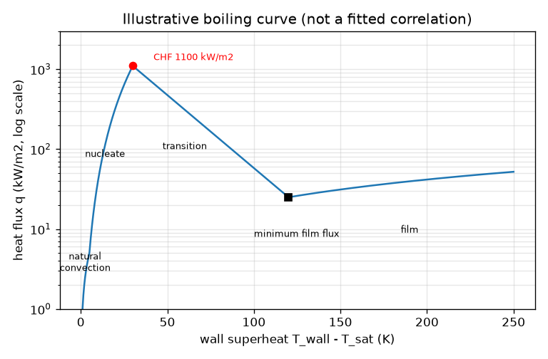
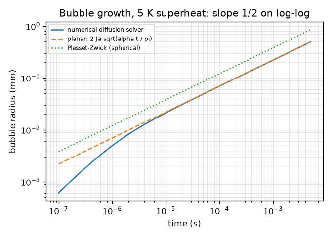
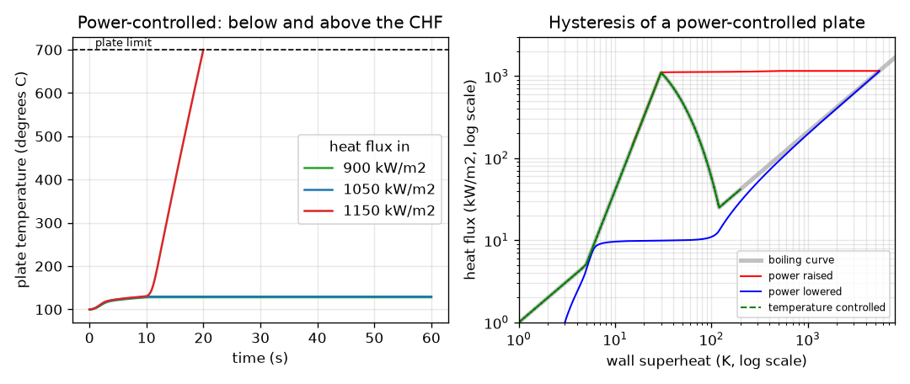

# Session 3: A heated plate, the burnout and the growing bubble

*Level 3 (simulation and validation) · about 90 minutes · openboiling*

> This is a simplified educational model. It is not a validated design tool and must not be used for real structures, electrical installations, vehicles, industrial processes or medical decisions.

**Prerequisites**

- Session 1: the boiling curve.
- Session 2: q = C dT^3, the critical heat flux, the heat flux of a heater.

**Learning objectives.** After this session you can:

- Step a lumped plate through time with a piecewise boiling curve and see the transitions between regimes.
- Show that power-controlled heating burns out above the critical heat flux while temperature-controlled heating does not, and describe the hysteresis.
- Validate the solver against an exact solution and against energy conservation.
- Check that a bubble grows as the square root of time with a log-log fit, and use a simulation to choose a safe heater power.

## A. Real-world problem
A heater plate sits in water. Turn the power up slowly and the plate stays only a few tens of kelvin above 100 C while the water boils vigorously. Turn it up a little too far and within seconds the plate is far too hot. That is burnout. Can a simple model show why, and why a thermostat that holds the wall temperature instead of the power does not burn out? (Educational model with illustrative coefficients; never use it to test or design real heating equipment.)

## B. Concept and theory
A thin plate of heat capacity C_p per unit area (J/(m2 K)) is heated by a flux q_in and cooled by boiling with the flux q(dT): C_p d(dT)/dt = q_in - q(dT). The boiling curve q(dT) is piecewise: natural convection h dT, nucleate boiling C dT^3 up to the critical heat flux, transition boiling falling (straight on a log scale) to a minimum, and film boiling rising slowly. These pieces and their coefficients are ILLUSTRATIVE: they give the right shape and a peak near 1.1 MW/m2 and are not a correlation fitted to data. In steady state q_in = q(dT). Below the CHF the nucleate branch has a stable solution: if the plate warms, q rises faster than q_in and cools it back. Above the CHF no nucleate solution exists: q_in exceeds the largest flux, the plate keeps warming, passes through the falling transition branch (where warming reduces cooling, a runaway) and lands on the film branch at a far higher temperature. When power is lowered again the plate stays on the film branch until the flux drops to the film minimum: this is hysteresis. If instead the wall temperature is held, the heater supplies whatever q(dT) is, and the curve is walked in either direction without a jump. A bubble grows because liquid near the wall is superheated by dT_sup; its growth is controlled by heat diffusion into the bubble surface. The Jakob number Ja = rho_l cp dT_sup / (rho_v L) is the ratio of sensible heat in the superheated liquid to the latent heat of the vapour; in a thin thermal layer the radius is R = 2 Ja sqrt(alpha t / pi) (planar), and the classic spherical Plesset-Zwick scaling is R = 2 sqrt(3 / pi) Ja sqrt(alpha t), sqrt(3) times larger. In both, R is proportional to the square root of time.

| Symbol | Meaning | Unit |
|---|---|---|
| dT | wall superheat T_wall - 100 C | K |
| q, q_in | boiling heat flux, supplied heat flux | W/m2 |
| C_p | plate heat capacity per area (17 250 for 5 mm copper) | J/(m2 K) |
| Q_chf | critical heat flux (illustrative 1.1e6) | W/m2 |
| surface | scales the nucleate coefficient (1 reference, 0.6 fouled) | no unit |
| Ja | Jakob number | no unit |
| alpha | thermal diffusivity of liquid water (1.68e-7) | m2/s |
| R | bubble radius | m |
| t | time | s |

**Assumptions**

- Lumped plate: one temperature, one heated face, other face insulated.
- Boiling curve single valued in dT, with illustrative coefficients.
- Explicit Euler time step 0.005 s (fastest time constant about 0.16 s).
- Bubble: planar thin-layer heat conduction; the spherical result is sqrt(3) larger. Real bubbles on a wall grow more slowly than the scaling because the superheated layer is thin.
- A plate over 700 C (superheat 600 K) is counted as burned out.

$$ C_p\,\frac{d(\Delta T)}{dt}=q_{\mathrm{in}}(t)-q(\Delta T) $$

$$ q(\Delta T)=\begin{cases}\max(h\,\Delta T,\ C\,\Delta T^{3}) & \Delta T\le\Delta T_{\mathrm{chf}}\\ \text{log-linear fall to }q_{\min} & \Delta T_{\mathrm{chf}}<\Delta T\le\Delta T_{\min}\\ q_{\min}\,\Delta T/\Delta T_{\min} & \Delta T>\Delta T_{\min}\end{cases} $$

$$ \Delta T(t)=\frac{q_{\mathrm{in}}}{h}\left(1-e^{-h t/C_p}\right)\quad\text{(exact, natural convection only)} $$

$$ \int q_{\mathrm{in}}\,dt-\int q\,dt=C_p\,\Delta T(t_{\mathrm{end}})-C_p\,\Delta T(0) $$

$$ R_{\mathrm{PZ}}=2\sqrt{\tfrac{3}{\pi}}\,\mathrm{Ja}\sqrt{\alpha t},\qquad \mathrm{Ja}=\frac{\rho_l c_p\,\Delta T_{\mathrm{sup}}}{\rho_v L} $$

## C. Visual explanation
The first figure shows the plate temperature in time for three power-controlled runs. At 900 and 1050 kW/m2 the plate settles at 128 and 130 C (steady superheats 28.1 and 29.5 K). At 1150 kW/m2, only 4.5 percent above the critical heat flux, it first looks fine, then runs away and reaches the plate limit after 20 s. The second panel plots the heat flux against the wall superheat on logarithmic axes: with power controlled, the point rides the nucleate branch to the peak, jumps horizontally to the film branch at about 1100 kW/m2 and, as the power is lowered, stays on the film branch until the flux is far lower, near 13 kW/m2, before falling back; with temperature controlled (green), the curve is traced there and back with no jump. The third figure plots bubble radius against time on log-log axes: the diffusion solver (solid) lies on the planar formula (dashed) with a slope of 0.5, and the Plesset-Zwick curve is sqrt(3) above it.

*Illustrative piecewise boiling curve with its four regimes, critical heat flux and film minimum.*

*Bubble radius against time at 5 K superheat on log-log axes: slope 0.5 for the solver, planar and Plesset-Zwick formulas.*

*Left: plate temperature for fluxes below and above the critical heat flux. Right: the hysteresis loop of a power-controlled plate against the temperature-controlled path.*

## D. Interactive simulation
Run the lesson (`python start.py 3`), then open the live app: [Session 3: a plate cooled by boiling](https://krunalpanchal1995.github.io/openboiling/session-03/) (or `app.html` in this folder). Raise the heat flux slowly toward 1100 kW/m2 and watch the trace and the boiling-curve view; then step over it and see the runaway. Change the surface factor and the plate thickness and see how the burnout time and steady superheat change.

**Challenge.** Keep the plate safe: heat flux at most the critical heat flux and a steady superheat of at most 25 K, on this surface.

## E. Worked example and experiment
**Problem.** Apply a heat flux of 600 kW/m2 to the reference plate. Find the steady wall superheat by hand and check it against the simulation; then check the stepper against the exact solution for a constant 3000 W/m2.

1. At steady state q_in = C dT^3 with C = 1.1e6 / 30^3 = 40.74 W/(m2 K3).
2. dT = (600 000 / 40.74)^(1/3) = 14 727^(1/3) = 24.5 K, so the plate is at 124.5 C.
3. Simulation: after a 60 s run with the heat flux ramped in over 10 s, dT = 24.51 K. They agree to 0.01 K.
4. For q_in = 3000 W/m2 the plate is in natural convection and the exact solution is dT = 3 (1 - exp(-t / 17.25 s)).
5. The stepper's maximum error over 60 s is 0.0002 K; the energy in, out and stored balance to 1e-14 of the input.

**Answer.** 600 kW/m2 gives a steady superheat of 24.5 K (124.5 C), found by hand and by the simulation; the solver reproduces the exact exponential to 0.0002 K.

**Experiment.** The real analogue is a heated metal block or a thin wire quenched in a water bath, with power raised in small steps while measuring its temperature; hobbyists should not try this, as burnout can destroy equipment and cause burns. In a laboratory, the plate temperature stays near 125 to 130 C and jumps to hundreds of degrees at the critical heat flux. Model versus reality: the coefficient and the exact flux of the jump depend on the surface, the water level and the heater size and are not those of this model; the transition branch is unstable and cannot be held in a power-controlled experiment; the real plate is not lumped.

## Real-world application and mini-project: Choose a safe heater power for a boiling surface
A flat heater of area 0.04 m2 (200 cm2 square) sits in water at 1 atm. The same heater must stay safe whether its surface is new (surface factor 1.0) or fouled (0.6). Safe means: the heat flux is at most 60 percent of the critical heat flux, the steady wall superheat is at most 25 K on both surfaces, and a 20 percent power overshoot does not burn the plate out in the Session 3 simulation. Use `design_check` and `max_safe_power` from Session 3. The coefficients are illustrative, so this is an exercise in method, not a real heater specification.

**Deliverable:** A script that prints, for each power from 5 kW to 30 kW in steps of 1 kW, whether the design passes and why it fails, names the largest safe power, and saves a picture of the boiling curves of both surfaces with the safe and the naive operating points marked.

**Success looks like:** The largest safe power is reported (it is 15 kW, a flux of 375 kW/m2 with a worst superheat of 24.8 K); the naive 60 percent of CHF choice (26 kW) is shown to fail on the fouled surface.

## F. Assessment and design challenge
**Question type A: Conceptual.** Why does a power-controlled heater burn out when the heat flux exceeds the critical heat flux, while a temperature-controlled one does not?

Hint

Compare q_in = q(dT) with the shape of the boiling curve past the peak.

Step-by-step solution

Above the CHF no nucleate-boiling state can carry the supplied flux: the plate warms, enters transition boiling where a higher temperature means a lower flux, so cooling falls as heating continues, and it runs away to the film-boiling branch at a far higher temperature. A temperature-controlled heater sets dT, so the heat flux is whatever the boiling curve gives, whatever the shape; the control reduces the supplied power if the flux falls, so there is nothing to run away.

**Question type B: Numerical.** Use the hand calculation to find the steady superheat for 1000 kW/m2 on the reference surface and for the same flux on the fouled surface (factor 0.6). What happens on the fouled surface?

Hint

dT = (q / (C surface))^(1/3), with C = 40.74.

Step-by-step solution

Reference: (1.0e6 / 40.74)^(1/3) = 29.1 K. Fouled: C = 24.44, dT = (1.0e6 / 24.44)^(1/3) = 34.5 K. The critical heat flux is still 1.1 MW/m2 (the peak is now at 35.6 K), so it stays below the peak but the wall runs 5 K hotter and the margin to the peak is thin. Units: kelvin above 100 C, so about 129 C and 135 C.

**Question type C: Graph and simulation interpretation.** In the hysteresis figure the jump up is at about 1100 kW/m2 and the return at about 13 kW/m2. What does this tell an operator who sees the plate burn out and then reduces the power by 20 percent?

Hint

Where is the plate sitting on the curve after the jump?

Step-by-step solution

The plate is now on the film-boiling branch and stays there until the flux falls to the order of the film minimum, about 25 kW/m2 (13 kW/m2 in the simulation, which lags because the plate takes time to cool). A 20 percent reduction brings the flux to about 880 kW/m2, about 70 times higher than the return flux, so the plate stays burned out. The operator must remove nearly all of the power, not just back off a little.

**Question type D: Design and optimisation challenge.** Design: a 0.04 m2 heater must be safe on a new and a fouled surface with a 20 percent power overshoot, at most 60 percent of the CHF and at most 25 K superheat. Find the largest safe power on a 1 kW grid. Is 60 percent of the CHF alone sufficient?

Hint

Use design_check(P, 0.04) for P from 14 to 27 kW.

Step-by-step solution

The 60 percent limit alone allows a flux of 660 kW/m2, i.e. 26.4 kW, but at 26 kW the fouled surface runs 29.8 K above boiling, above the 25 K limit. The largest safe power on the grid is 15 kW: a flux of 375 kW/m2 gives 21.0 K (new) and 24.8 K (fouled). 16 kW gives 25.4 K on the fouled surface and fails. A 20 percent overshoot (450 kW/m2) is far below the CHF so it does not burn out. Trade-off: the superheat limit on a fouled surface governs the design, not the CHF. The constants are illustrative, so this is a method, not a specification.

Score yourself with [RUBRIC.md](../../RUBRIC.md). Print the [activity sheet](activity_sheet.md) to work on paper.

## Common misconceptions
| Common misconception | What is actually true |
|---|---|
| Burnout happens slowly because the plate warms gradually. | Past the critical heat flux the temperature runaway is quick: seconds for a thin plate, and thicker plates only delay it. |
| Reducing the power slightly after burnout restores normal boiling. | The film-boiling state persists until the flux falls to the film minimum, tens of times lower than the burnout flux (hysteresis). |
| A numerical solver is right if it runs without errors. | It must be checked against an exact solution and against energy conservation, as this session does. |
| Bubble radius grows in proportion to time. | Diffusion-limited growth gives radius proportional to the square root of time; the slope of a log-log plot is 0.5, not 1. |

## Glossary
- **burnout**: sudden overheating of a heated surface when the critical heat flux is exceeded
- **hysteresis**: the system's state depends on its history: the jump up and the fall back happen at different fluxes
- **film boiling**: boiling with a continuous vapour blanket between the surface and the liquid
- **Jakob number**: ratio of sensible heat in the superheated liquid to latent heat of the vapour
- **lumped model**: one temperature for the whole body
- **log-log plot**: plot with logarithmic axes where a power law is a straight line whose slope is the exponent
- **Plesset-Zwick**: the classic result that a vapour bubble in superheated liquid grows with the square root of time

## Finish
1. Do the three coding tasks in [exercises.md](exercises.md).
2. Run `python start.py 3` again after your changes. It ends with the checkpoint; when it prints `PASS`, you are done. (Checkpoint only: `python start.py check 3`.)

Next: the [roadmap](../../promo/roadmap.md). Session 4 is yours to build.
